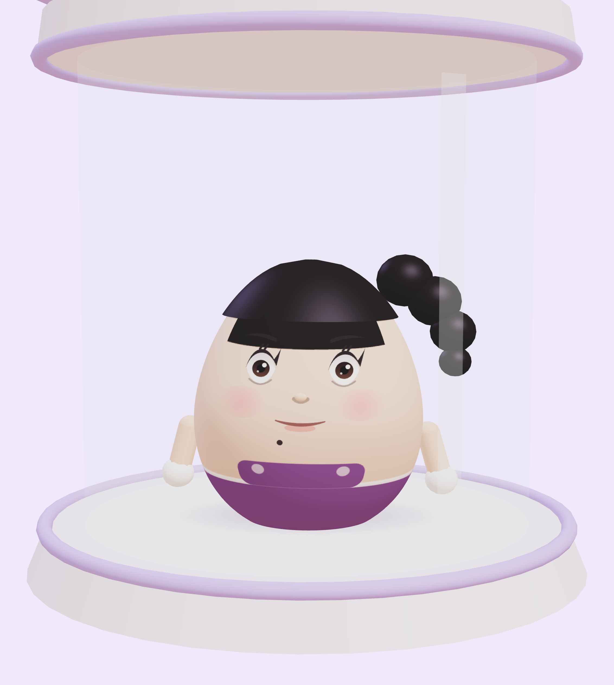

<div align="center">

# 🥚 Eggsplaining

**Hold to pump a very nervous egg. Let go to bank. Don’t pop her.**
*Then explain yourself to the entire planet on the world leaderboard.*

[-ff6f91?style=for-the-badge)](https://yesjermo.github.io/eggsplaining/)
[](https://github.com/yesjermo/eggsplaining/actions/workflows/pages.yml)




</div>

## What is this

A party game about one egg and your complete lack of restraint. You hold a button, pressure builds inside her little glass test chamber, and the points pour in. Let go and you bank them. Keep holding and, well. She has a line she says after that, and you can write it yourself.

There's no pressure meter. The gauge in the chamber is wearing a tiny cover, because you are supposed to *read her face*, like a decent person.

## How to play

1. **Hold** Space, or the big button on your phone. Points come faster the longer you hold.
2. **Let go** to bank them. She cools down a little. Not enough.
3. **Don’t pop her.** If you do, that hold’s points are gone and her soul floats out of the chamber, judging you.

A hold shorter than a beat banks nothing, so mashing doesn't work. Switching tabs or having your phone cancel the touch counts as letting go, so you can't escape that way either.

### Modes

| Mode | Vibe |
| --- | --- |
| **Classic** | One egg, one pop. Every bank makes her touchier: pressure builds faster and holds pay more. How far can you push her? |
| **ADHD mode** | 45 seconds. Faster everything. Banks in a row build a combo up to ×5. A pop costs 3 seconds and your combo, not your dignity. Space restarts instantly, because you were going to anyway. |

Each mode has its own **world leaderboard** for today and all time, with flags and a tiny Mii of every player. One best score per person, so no, playing 400 times doesn't put you on the board 400 times.

## Reading her (a field guide)

She will lie to you. Sometimes. These cues are consistent and never faked:

- 👀 **Blinking:** calm is about every 3 seconds; near the end, several times a second.
- 😳 **Cheeks:** they flush and puff out the harder you push.
- 🪵 **Creaking:** starts past halfway and speeds up. That's not a floorboard.
- 💔 **Cracks:** only appear in the last quarter. If you see one, you have made choices.

These ones are fake: a serene little grin right before she pops, and a panic face when she's actually totally fine. She also:
- taps her foot when you hesitate
- glances at the covered gauge on long holds
- says *“I’m fine.”* while visibly shaking, which she is not

## Make her yours

Hit **Make her yours** for a Mii Maker:

| Tab | What you can change |
| --- | --- |
| Face | skin, height, roundness |
| Hair | 9 styles, 5 bangs, colour |
| Eyes | 5 styles, size, spacing |
| Brows, Nose, Mouth | shapes, plus lip colour |
| Extras | mole, blush, freckles, glasses and frame colour, favourite colour |
| Name | her nickname, her after-pop line, your leaderboard name, your country |

The default is a real friend, lovingly egg-ified (`src/shared/look.js`): sleek black hair parted in the middle with soft curtain bangs and a low bun, sleepy monolid eyes, round cheeks, a chin mole and a purple top. Say hi to Peggy.

## Three ways to see her

Pick a style under her preview in the Mii Maker. It switches straight away and is remembered.

| Style | What it is |
| --- | --- |
| **Cartoon** | The default. A flat, outlined 2D cut-out that moves like jelly. No 3D library at all. |
| **3D** | The very first design, brought back: a smooth 3D egg in a glossy pastel chamber, with the original Mii face painted on and little overalls. |
| **3D Mii** | Mii proportions: a big round head on a small body, a white collar, stubby arms and tiny legs, with her cute flat Mii face. |

Three.js (about 134 KB gzipped) only downloads when someone picks a 3D style, so Cartoon players get the whole game in about 24 KB.

## How she's made

- **Her (Cartoon):** a flat **cut-out** with the original Mii face, made cuter (`src/face2d.ts`): bigger eyes with two sparkles and round blush. Every part is a flat colour cel with a bold ink outline. Stubby arms, little legs and round sneakers are drawn on the same canvas (`src/render/egg.ts`), which is only repainted when her pose changes.
- **Hair:** a natural shape that hugs her head, parts in the middle and sweeps down into soft curtain bangs with tapered ends. Faint strand lines follow the way it falls, and her low bun peeks out behind.
- **Her (3D styles):** `src/render3d/` is the first version's Three.js egg, rebuilt around a shape profile. **3D** keeps the tall egg and the original face. **3D Mii** swaps in a round head, a small body and the cute face. Both paint the face onto the head as a texture and share the same expressions and tells.
- **How she moves:** like jelly. A springy squash-and-stretch wobbles her whenever anything changes, she does little idle hops while she waits, a happy hop and wave on every bank, and squishes down as you hold. Her cheeks puff, cracks spread and, after a pop, her hair stands on end and she keels over with a bounce.
- **Everywhere else:** the cartoon drawing also makes the Mii Maker previews and the leaderboard avatars.
- **Stage (Cartoon):** a translucent cartoon test chamber in plain **Canvas 2D**, with no WebGL. The static parts are painted once per resize, so each frame costs well under a millisecond.
- **UI:** minimal frosted glass. Panels let the soft pastel background show through, with a light sheen and a hairline rim, and colour is saved for the moment you hold.
- **Leaderboard:** **Supabase**. The tables are locked, and the browser can only call three functions that check every score (see Hosting).
- **Hosting:** **GitHub Pages**, built by an Action on every push.

To regenerate the splash GIF, run `npm run dev`, then open `/?gif=1`. It's written to `marketing/splash.gif` and `public/splash.gif`.

## Run it

```bash
npm install
npm run dev     # game + a local leaderboard on http://localhost:5173
npm test        # 37 tests (see below)
npm run deploy  # = git push; the Action tests, builds and publishes
```

## Hosting

**Game:** GitHub Pages at https://yesjermo.github.io/eggsplaining/. `.github/workflows/pages.yml` runs the tests, builds with the repo's base path and deploys on every push to `main`. If the tests fail, nothing ships, and she stays safe.

**World leaderboard:** Supabase. `supabase/schema.sql` creates two tables that row level security keeps locked. The browser can only call:
- `start_run(mode)`: returns a single-use run id
- `submit_score(...)`: checks the run's mode and age, a points-per-second ceiling (the same one as `src/shared/limits.js`) and per-IP limits. It also cleans the name, country and avatar.
- `leaderboard(mode, period, limit, player)`: returns each player's best for today or all time, plus your rank

The Action reads two **repo variables**, `VITE_SUPABASE_URL` and `VITE_SUPABASE_ANON_KEY`. Both are public: the project URL and the *publishable* key, which ship inside the game anyway. Never put the `service_role` or secret key anywhere near this repo.

To use your own Supabase project:
1. Run `supabase/schema.sql` in its SQL Editor.
2. Set the two repo variables (Settings → Secrets and variables → Actions → Variables).
3. Push.

For local builds, the same values can go in a git-ignored `.env.production`. With neither set, the game still works with personal bests only.

To clear test scores, run this in the Supabase SQL Editor:
```sql
delete from scores where name = 'Setup test';
```

**Local dev:** `npm run dev` mounts a local copy of the leaderboard (`server/api.mjs`, saved in `.data/`), so you can pop her all day without touching the real board. `server.mjs` serves the build plus that API if you ever self-host (`npm run build && npm start`, port 8787).

## Code map

| Path | What it does |
| --- | --- |
| `src/game/state.ts` | The rules, for both modes. Pure: time only moves when you call `tick(dt)` |
| `src/game/holdInput.ts` | Turns keys, touches, cancelled touches and tab switches into press/release |
| `src/shared/look.js`, `limits.js` | The Mii schema and validation, plus score ceilings shared with the servers |
| `src/face2d.ts` | Her Mii face, hair and outlined cartoon cels, plus the sketchy ghost for the splash |
| `src/render/egg.ts` | The cartoon cut-out: expressions, limbs, squash, wobble, sweat, the fall |
| `src/render/scene.ts` | The 2D chamber, confetti, shell shards, the soul, the camera |
| `src/render3d/` | The 3D styles: the first design's egg and the 3D Mii, in Three.js |
| `src/settings.ts` | Your look, style, name, country and bests, kept in this browser |
| `src/splash.ts` | Soul-leaving-body splash and GIF export |
| `src/ui/miimaker.ts` | The Mii Maker |
| `src/leaderboard.ts` | Leaderboard client: Supabase when live, local API in dev |
| `supabase/schema.sql` | The real leaderboard tables and functions |
| `server/` | Local and self-host leaderboard API |
| `.github/workflows/pages.yml` | Test, build, deploy |

## Tests

`npm test` runs 37 tests:
- **Rules:** holding, banking, too-early releases, pops mid-hold, long frames, both modes, combos, the score ceiling, fake tells.
- **Input:** key auto-repeat, cancelled touches, second fingers, tab switching, button-mashing.
- **Leaderboard:** the local API, plus the Supabase SQL in an in-memory Postgres. That includes proof that the public key can't touch the tables directly.

<div align="center">

*No eggs were permanently harmed. She resets every round. She remembers, though.*

</div>
