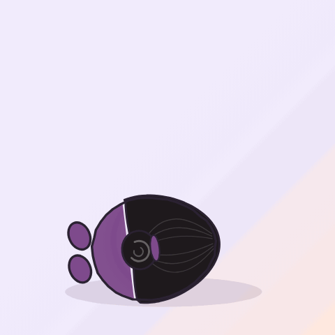

# Eggsplaining

Hold to pump a very nervous egg. Let go to bank the points. Don’t pop her. Then see where you rank against everyone else in the world.



```bash
npm install
npm run dev      # game + leaderboard API on http://localhost:5173
npm test         # game rules, input edge cases, leaderboard API (vitest)
npm run build && npm start   # production server on :8787
```

## Modes

- **Classic:** one egg, one pop. Every bank cools her off a little, moves the hidden line, and makes her touchier: pressure builds faster and holds pay more. Your score is everything you banked before the pop.
- **ADHD mode (Blitz):** 45 seconds, faster pressure, and consecutive banks build a combo (×1.5, ×2 … up to ×5). A pop wipes the hold and the combo and costs 3 seconds, but the run keeps going. Haptics on Android, pop-up scores, and an instant restart with Space.

Both modes have their own world leaderboard (today and all time). Each player keeps one best score per board.

## Reading her

These cues are consistent and never faked:
- Blink rate goes from about every 3 s to several times a second.
- Her cheeks flush.
- A creak sound starts past halfway.
- Cracks appear in the last quarter.

The fake tells are a serene grin near the edge and a panic face when she's actually safe.

## The character

The face is painted Mii-style onto the egg as a canvas texture. The same 2D renderer (`src/face2d.ts`) draws the Mii Maker thumbnails, the leaderboard avatars, the splash and the soul that floats out when she pops.

Mii Maker tabs:
- **Face:** skin, height, roundness
- **Hair:** 9 styles, 5 bangs, colour
- **Eyes:** 5 styles, size, spacing
- **Brows, Nose, Mouth:** with lip colour
- **Extras:** mole, blush, freckles, glasses and frame colour, favourite colour
- **Name:** nickname, after-pop line, leaderboard name, country

The default preset is in `src/shared/look.js`: low bun with wispy curtain bangs, sleepy eyes, round cheeks, a chin mole and a purple top.

## Structure

| Path | Role |
| --- | --- |
| `src/game/state.ts` | Pure rules for both modes, time passed in via `tick(dt)`, injectable RNG |
| `src/game/holdInput.ts` | Keyboard / pointer / touch-cancel / tab-switch → press & release |
| `src/shared/look.js`, `limits.js` | Look schema + validation and score ceilings, shared with the server |
| `src/face2d.ts` | Mii-style 2D face, hair, egg head, ghost |
| `src/splash.ts` | Soul-leaving-body splash animation + GIF export |
| `src/render/` | Lightweight Three.js stage (Lambert lighting, no shadow maps), loaded after the splash |
| `src/ui/miimaker.ts` | Mii Maker sheet |
| `server/api.mjs` | Leaderboard API: run tokens, plausibility check, rate limits, best per player |
| `server/store.mjs` | JSON storage with optional GitHub backup |
| `server.mjs` | Production server (static files + API), zero dependencies |

Regenerate the splash GIF: run `npm run dev` and open `/?gif=1`. It's written to `marketing/splash.gif` and `public/splash.gif`.

## Her 3D head (Blender)

`tools/blender/build_head.py` sculpts her head in Blender and exports `public/models/egg-head.glb` (about 380 KB). It includes:
- round cheeks and a soft jaw
- eyes with upper lids
- brows, a button nose, a closed mouth and an open mouth
- her low bun with a tie, face-framing strands, and wispy curtain bangs

Shape keys drive the expressions (Close/Sleepy/Wide lids, Worry/Angry/Raise brows, Flat/Wavy/Frown/Big/Small lips, Grin/O mouth, cheek Puff). The game eases between them every frame, so she blinks, glances, strains and grins smoothly instead of snapping. Rebuild after editing the script:

```bash
/Applications/Blender.app/Contents/MacOS/Blender -b --factory-startup --python tools/blender/build_head.py
```

## Hosting (GitHub Pages + Supabase)

The code stays in this private repo. `npm run deploy` builds the game and publishes only the built files to the public repo `yesjermo/eggsplaining-site`, served at https://yesjermo.github.io/eggsplaining-site/.

The world leaderboard lives in a free Supabase project:
1. Create a project at supabase.com. Open **SQL Editor**, paste `supabase/schema.sql` and run it. The tables stay locked, and the browser can only call `start_run`, `submit_score` and `leaderboard`, which check each run's time, the score ceiling and rate limits.
2. Copy the **Project URL** and the **anon public** key from Project Settings → API into `.env.production`:
   ```
   VITE_SUPABASE_URL=https://xxxx.supabase.co
   VITE_SUPABASE_ANON_KEY=eyJ...
   ```
   The anon key is meant to be public. Never use the `service_role` key here.
3. Run `npm run deploy` again.

Without those values the site works with personal bests only. `npm test` runs the SQL against an in-memory Postgres (PGlite).
